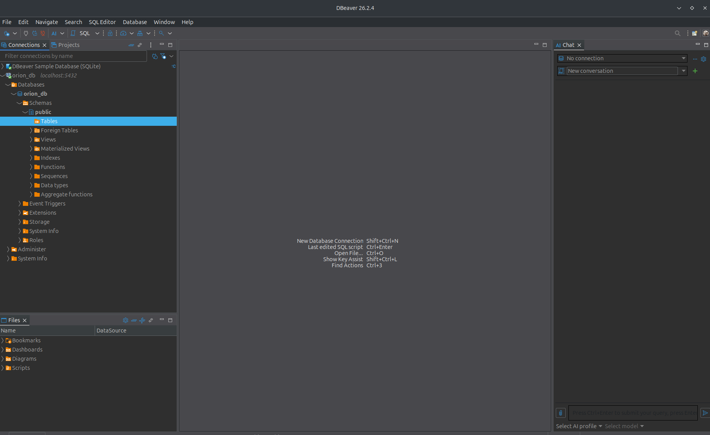
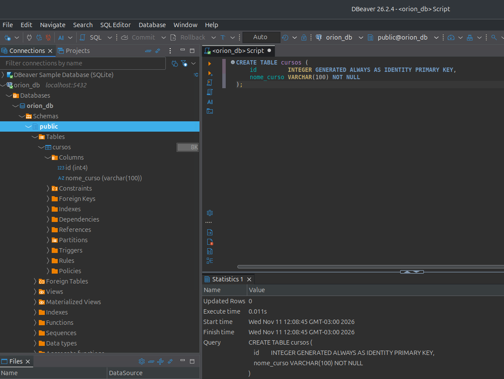
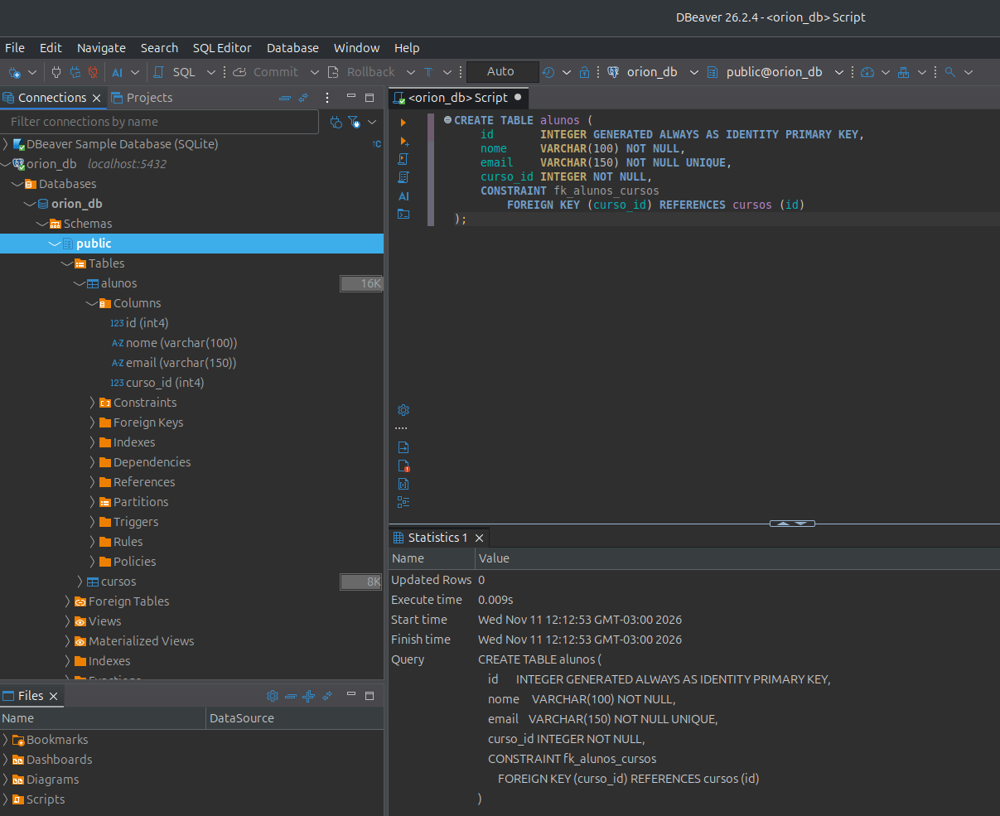
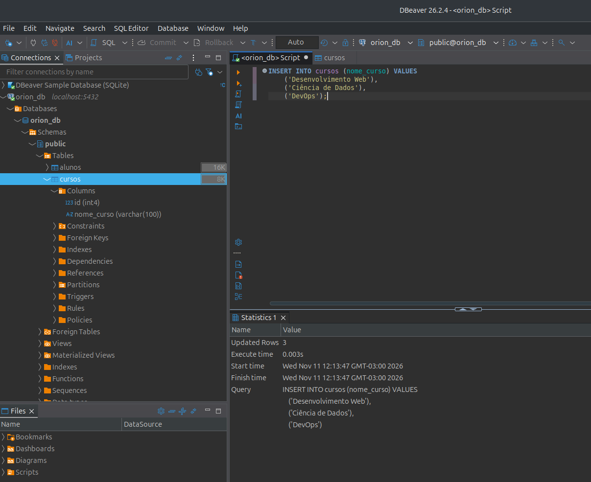
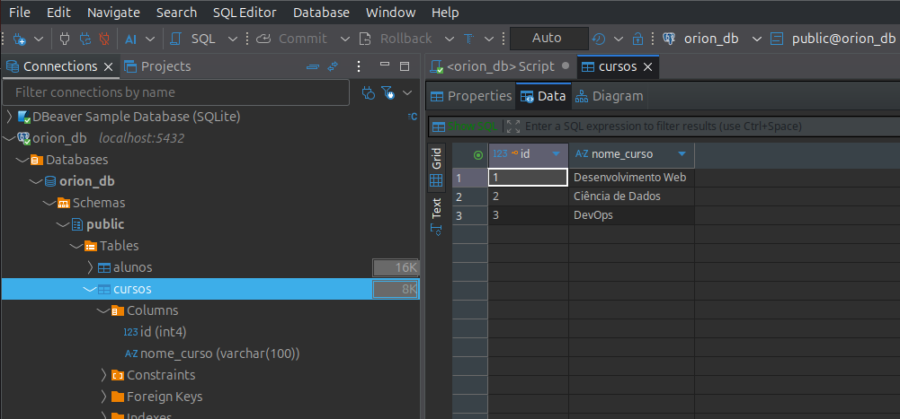
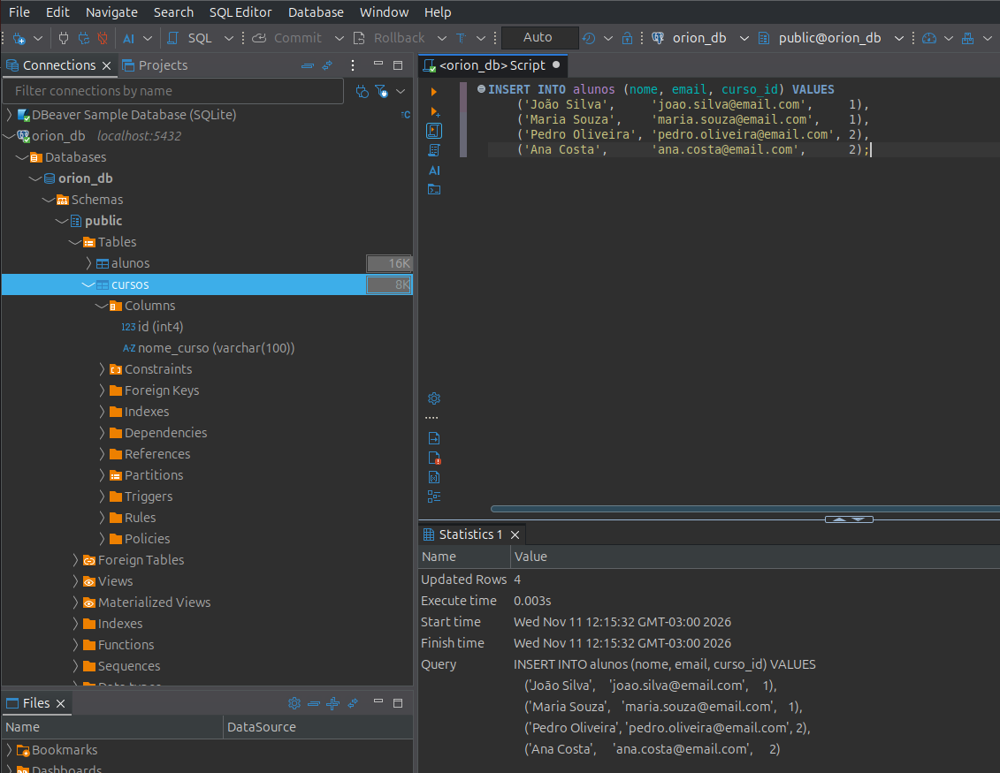
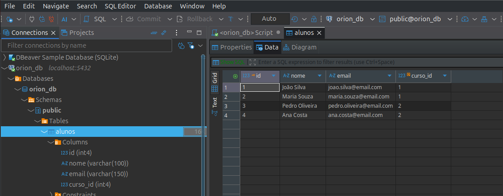
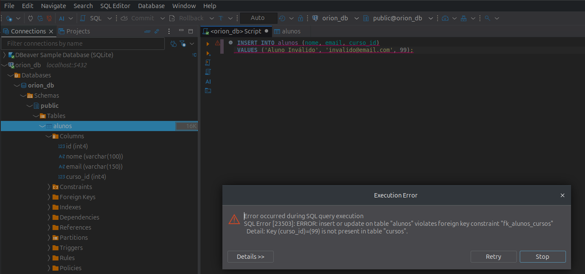
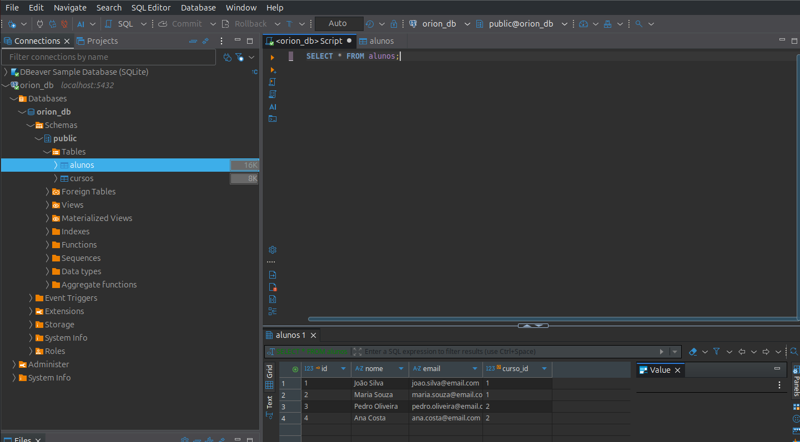

## Conexão com o Banco de Dados
### Conexão Mongo

### Conexão Postgtresql

## Exercício 1
### Criar a tabela cursos

### Criar a tabela alunos

### Insira 2-3 cursos na tabela cursos.

### Insira 3-4 alunos na tabela alunos, relacionando-os com os cursos que você criou.

### A Chave Estrangeira impede que você insira um aluno com um curso_id que não existe.

### O comando SELECT * FROM alunos; retorna todos os alunos que você inseriu.
