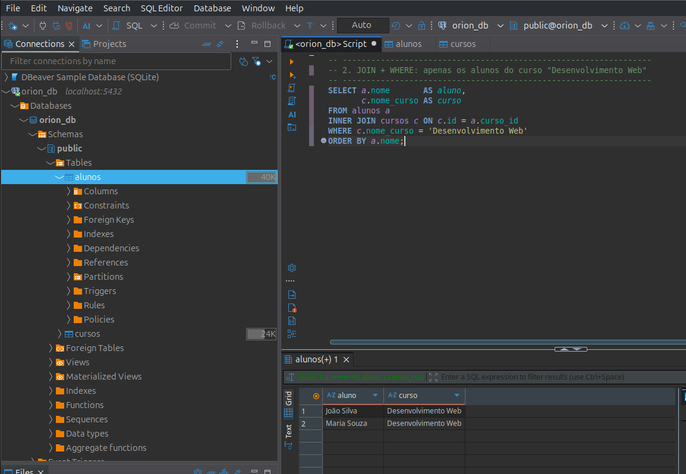
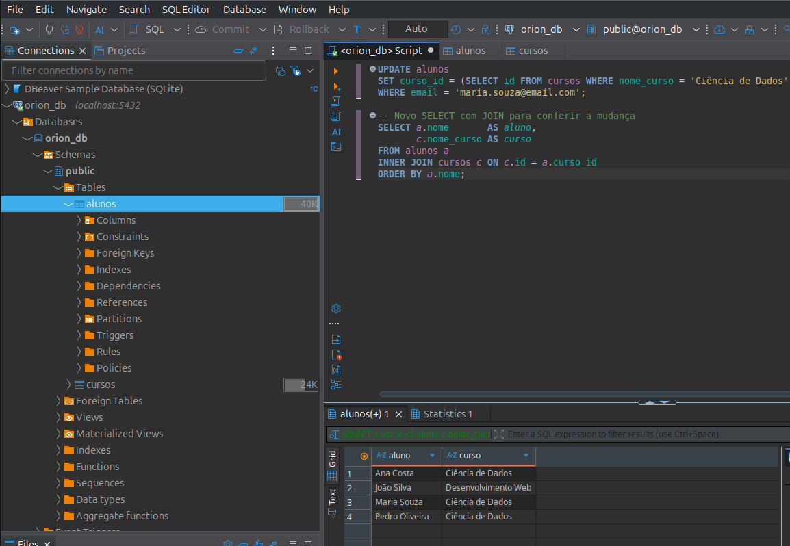
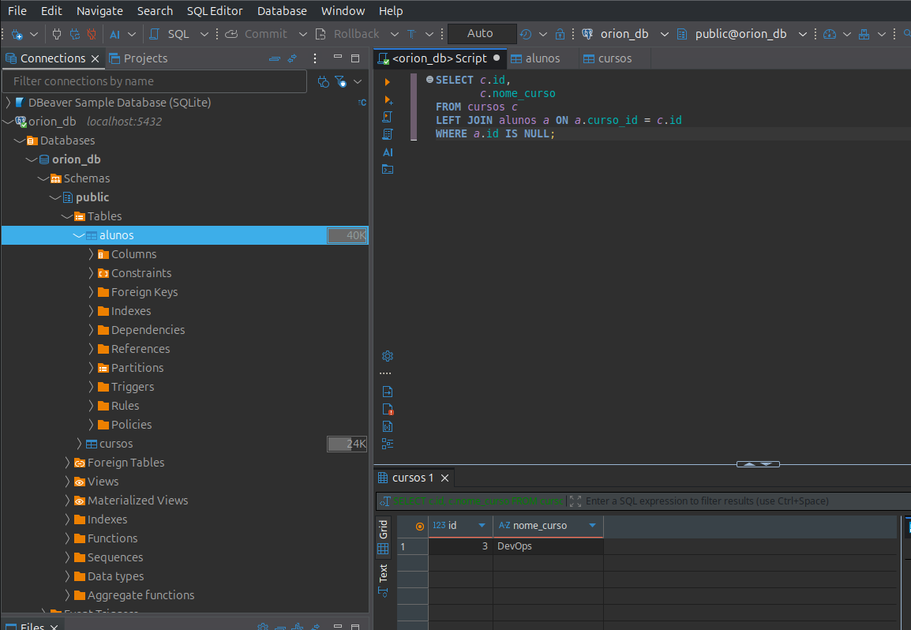

## Exercício 2 - JOINs e Filters

### 1. Escrever um SELECT que:
  - Use INNER JOIN para mostrar o nome do aluno e o nome do curso que ele está fazendo, em uma única consulta.

2. Escrever um SELECT que:
  - Use WHERE e JOIN para mostrar apenas os alunos que estão no curso de, por exemplo, "Desenvolvimento Web"
  

3. Executar um UPDATE que:
  - Altere o curso_id de um aluno específico ex: "Mover Maria para o curso de Ciência de Dados").
  

4. EXTRA - Escreva um SELECT com LEFT JOIN e WHERE para descobrir quais cursos não
possuem nenhum aluno matriculado
