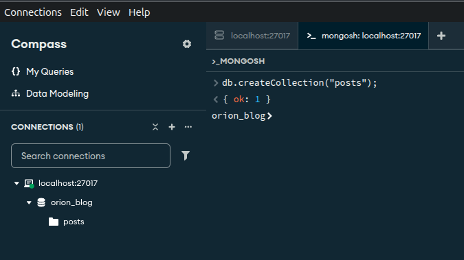
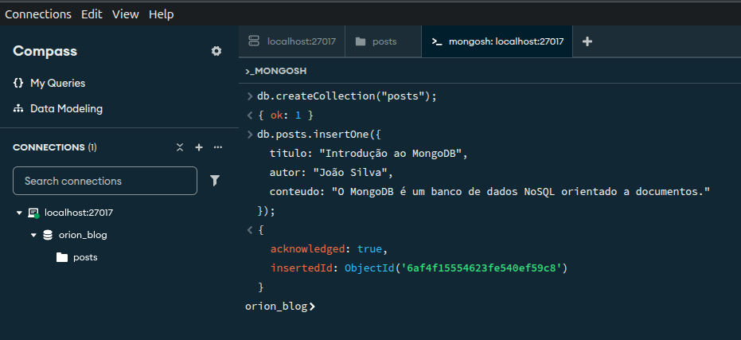
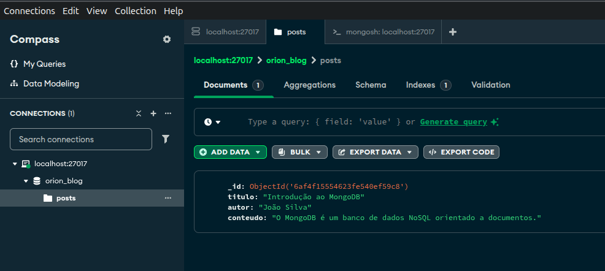
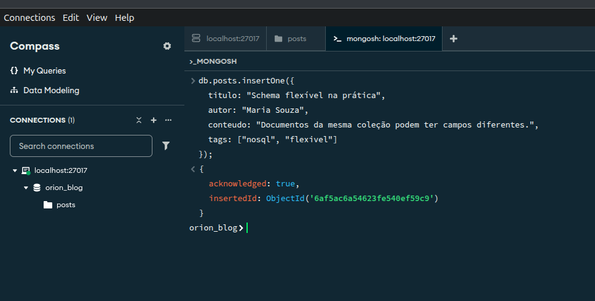
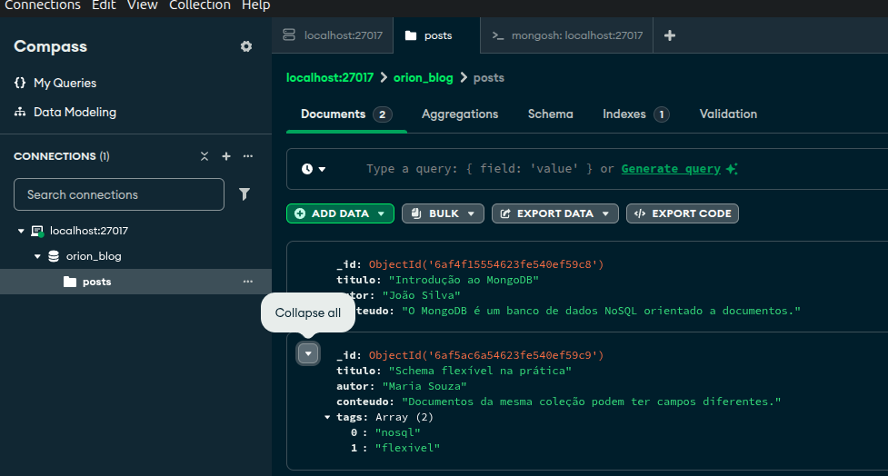
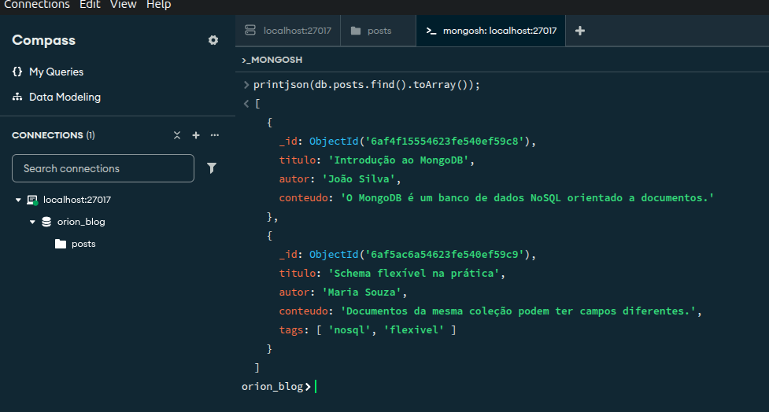

## Exercício 3 — Não relacional (CRUD Básico)

### 1. Criar uma coleção chamada **posts** no banco de dados.

### 2. Inserir (Create):
 - Insira um documento com: titulo, autor e conteudo.
 
 

 ### 3. Testar Schema Flexível:
  - Insira um segundo documento com: titulo, autor, conteudo e um campo novo: tags (um array de strings, ex: ["nosql", "flexivel"]).
  
  

### 4. Consultar (Read):
  - Use o comando find() para listar todos os documentos da coleção posts.
  