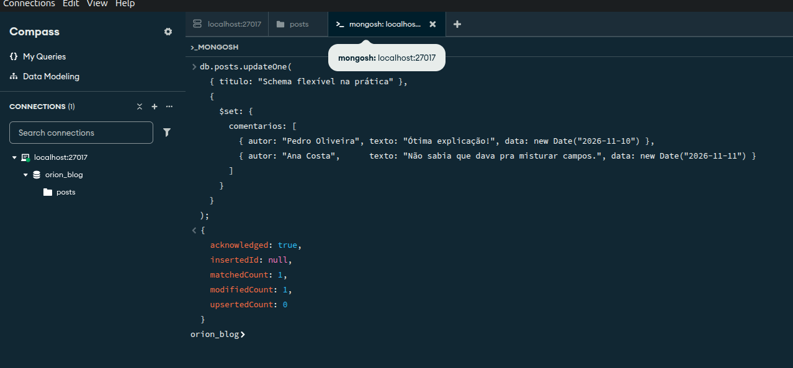
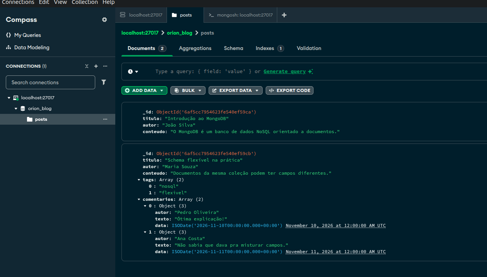
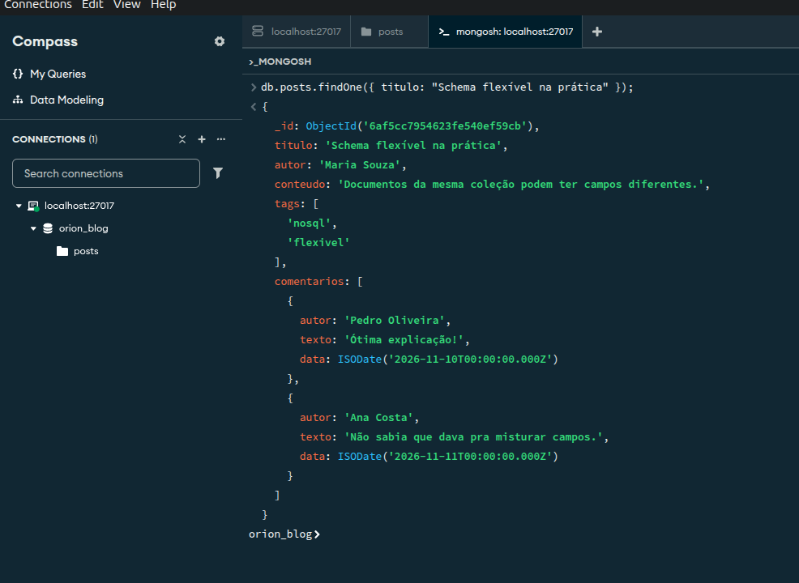
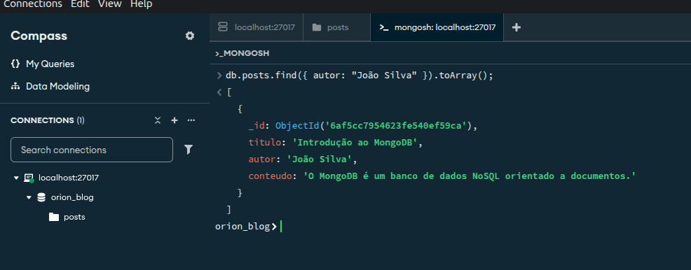
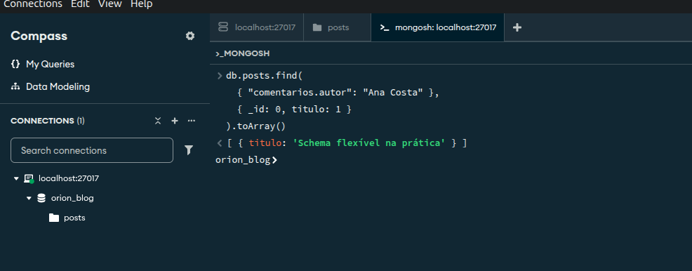

### 1. Atualizar (Update):
  - Use updateOne() para adicionar um campo comentarios em um dos seus posts.
  - comentarios deve ser um array de documentos.

### 2. Consulta dentro de um array: posts com a tag "nosql"

### 3. Consulta por campo específico: posts de um autor

### 4. Consulta por campo dentro de um array: posts com comentários de Ana Costa
